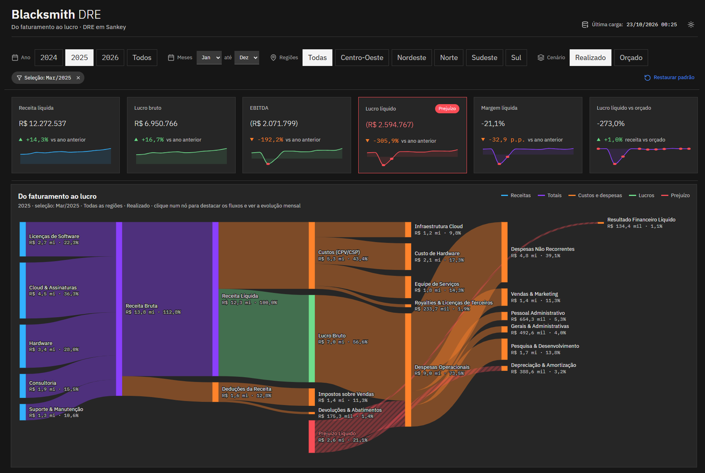

# Blacksmith: DRE em Sankey no Microsoft Fabric

Projeto de ponta a ponta no **Microsoft Fabric** que mostra, num gráfico de **Sankey**, como a receita de uma empresa se transforma em lucro, ou em prejuízo. O caminho completo:

**CSVs → modelo semântico Import (Power Query + DAX + testes de qualidade) → Fabric App (React + TypeScript)**

Toda a engenharia fica dentro do modelo: não há lakehouse, notebook nem pipeline. Um report de conferência, sobre o mesmo modelo, mostra os testes e os números de referência.

O app segue o **IBM Carbon Design System**, abre no tema escuro e tem tema claro. Clicar num ponto de um gráfico filtra os outros, como no Power BI.



*Mar/2025 selecionado na tendência: o EBITDA fica negativo e o nó **Prejuízo Líquido** passa a financiar despesas, D&A e resultado financeiro.*

> **Os dados são 100% fictícios.** A Blacksmith é uma empresa inventada, e a base foi gerada com semente fixa (seed 42). Se você adaptar o projeto para dados reais, anonimize-os antes e nunca versione dados de clientes.

---

## Sumário

- [O que tem no projeto](#o-que-tem-no-projeto)
- [Arquitetura](#arquitetura)
- [Requisitos](#requisitos)
- [Instalação passo a passo](#instalação-passo-a-passo)
- [Validação](#validação)
- [Segurança](#segurança)
- [Limitações conhecidas](#limitações-conhecidas)
- [Licença](#licença)

---

## O que tem no projeto

### O cenário

- **Blacksmith**, empresa de tecnologia (hardware, software, cloud e serviços) que atua nas 5 regiões do Brasil.
- **36 meses** (jan/2024 a dez/2026), em dois cenários: **realizado** e **orçado**.
- **Evento de prejuízo** para a demonstração: um recall de hardware e uma multa contratual, lançados só no realizado.
  - Em **mar/2025** a empresa fecha com **prejuízo de R$ 2,59 mi**.
  - Em **abr/2025**, com **prejuízo de R$ 0,61 mi**, e nesse mês só o Sudeste fica negativo.
  - O ano de 2025 inteiro continua lucrativo (R$ 13,09 mi).

<details>
<summary><strong>Ver o app inteiro</strong> (tendência mensal, regiões, DRE realizado × orçado e indicadores operacionais)</summary>


</details>

### Os entregáveis

| camada | item | o que faz |
|---|---|---|
| Modelo + report | `fabric-workspace/dre-sankey.pbip` | Modelo **Import**: o Power Query lê os 7 CSVs de `dataset/`, confere cabeçalho e tipos e cria `dim_cenario`. Tem 54 medidas DAX (DRE, margens, comparativos com o ano anterior e com o orçado, indicadores operacionais e o Sankey) e a tabela calculada `_qualidade`, com 50 testes. O report traz páginas de conferência: testes de qualidade, DRE anual, resultado mensal, links do Sankey, regiões e operacional. |
| App | `app-dre-sankey` | Fabric App com KPIs, Sankey, tendência mensal, regiões, tabela da DRE e painel operacional, além de filtragem cruzada e tema claro/escuro. |

### A lógica do prejuízo no Sankey

A medida `sankey_valor` calcula cada link sobre os valores já agregados no filtro. A receita líquida vai "pagando" cada camada de gasto, em cascata: custos, despesas operacionais, D&A, resultado financeiro e IR/CSLL.

- Quando a receita acaba, a parte não coberta de cada gasto passa a sair do nó **Prejuízo Líquido**.
- Os subtotais zerados (EBITDA, EBIT…) somem do gráfico.
- Somar links pré-calculados mês a mês mostraria lucro e prejuízo ao mesmo tempo. Calcular sobre o agregado evita isso.

---

## Arquitetura

```
dataset/*.csv
      │  Power Query
      ▼
dre-sankey (modelo Import + report de conferência, publicados do .pbip)
      │  Execute Queries API (@microsoft/fabric-app-data)
      ▼
app-dre-sankey (Fabric App, publicado com o Rayfin)
```

---

## Requisitos

### No Fabric

| requisito | por quê |
|---|---|
| Capacidade numa **região onde o Fabric Apps está disponível** | Confira em [Fabric region availability](https://learn.microsoft.com/en-us/fabric/admin/region-availability). |
| Workspace em **capacidade Fabric** (SKU F) | Fabric Apps não funciona em capacidade compartilhada nem em Pro. |
| Papel **Contributor** (ou superior) no workspace | Para publicar o modelo, o report e o app. |
| Workload **Fabric Apps** habilitado no tenant | Fabric Apps está em preview e precisa ser liberado pelo administrador. |
| Configuração **Semantic Model Execute Queries REST API** habilitada (também aparece como *Dataset Execute Queries REST API*) | O app consulta o modelo por essa API. |

### Na máquina

| ferramenta | para quê | instalação |
|---|---|---|
| Power BI Desktop | abrir e publicar o `dre-sankey.pbip` | https://www.microsoft.com/power-platform/products/power-bi/desktop |
| Node.js 20 ou superior (inclui o npm) | instalar as dependências e publicar o app | https://nodejs.org (versão LTS) |

O Rayfin, a ferramenta da Microsoft que publica Fabric Apps, não precisa ser instalado: o `npm install` já baixa ele junto com o app.

---

## Instalação passo a passo

### 1. Baixar o projeto

Nesta página do GitHub, clique em **Code → Download ZIP** e extraia o arquivo numa pasta da sua máquina.

### 2. Publicar o modelo e o report

1. Abra o `fabric-workspace/dre-sankey.pbip` no Power BI Desktop.
2. Clique em **Atualizar**: o projeto vem sem dados, e o Power Query baixa os 7 CSVs de `dataset/` (se pedir credencial, escolha **Anônimo**).
3. Clique em **Publicar** e escolha o seu workspace.

O modelo semântico e o report `dre-sankey` aparecem no workspace, já com os dados.

### 3. Publicar o app

Abra um terminal na pasta `app-dre-sankey`, dentro da pasta extraída, e rode:

```bash
# baixa as dependências do app (alguns minutos na primeira vez)
npm install

# abre o navegador para entrar com a sua conta do Fabric
npx rayfin login

# liga o app ao modelo: abra o modelo semântico dre-sankey no portal e copie a URL da barra de endereço
npm run bind -- "<URL do dre-sankey>"

# faz o build e publica o app no workspace
npx rayfin up --workspace <nome-do-workspace> --item-name app-dre-sankey
```

Abra o `app-dre-sankey` pelo workspace, no portal do Fabric.

---

## Validação

- No report `dre-sankey`, a página **Qualidade** deve mostrar `testes_com_falha = 0`.
- Os números do app batem com o report no mesmo recorte.

Números de referência (realizado, consolidado):

| métrica | 2024 | 2025 | 2026 |
|---|---|---|---|
| receita líquida | 135.461.230,60 | 154.819.681,80 | 175.717.045,70 |
| lucro líquido | 15.882.255,48 | 13.088.163,15 | 24.560.318,22 |
| margem líquida | 11,7% | 8,5% | 14,0% |

---

## Segurança

- O app não guarda credenciais. A autenticação é a nativa do Fabric (Entra ID), e cada usuário consulta o modelo com a própria identidade.
- Não cole dados reais de clientes em prompts, issues ou logs.

---

## Limitações conhecidas

- **Fabric Apps está em preview.** Comandos, pacotes e comportamento podem mudar.
- Apps ligados a modelo semântico só abrem **dentro do portal do Fabric**.
- Quem for usar o app, além de quem publicou, precisa de permissão **Build** e **Read** no modelo `dre-sankey`.

---

## Licença

[MIT](LICENSE). O código herdado do template de Fabric Apps da Microsoft, em `app-dre-sankey/`, mantém a licença MIT original ([app-dre-sankey/LICENSE](app-dre-sankey/LICENSE)).
