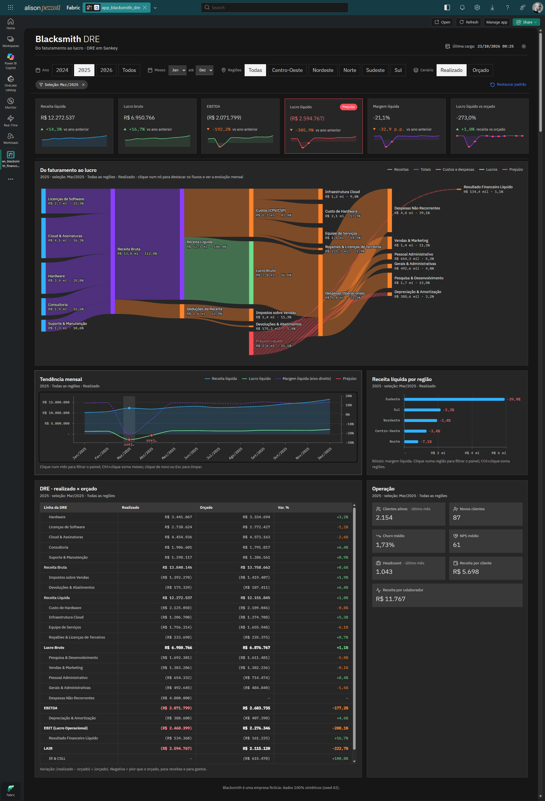

# Blacksmith: DRE em Sankey no Microsoft Fabric

Projeto de ponta a ponta no **Microsoft Fabric** que mostra, num gráfico de **Sankey**, como a receita de uma empresa se transforma em lucro, ou em prejuízo. O caminho completo:

**CSVs no GitHub → modelo semântico Import (Power Query + DAX + testes de qualidade) → Fabric App (React + TypeScript)**

Toda a engenharia fica dentro do modelo: não há lakehouse, notebook nem pipeline. Um report de conferência, sobre o mesmo modelo, mostra os testes e os números de referência.

O app segue o **IBM Carbon Design System**, abre no tema escuro e tem tema claro. Clicar num ponto de um gráfico filtra os outros, como no Power BI.


*Mar/2025 selecionado na tendência: o EBITDA fica negativo e o nó **Prejuízo Líquido** passa a financiar despesas, D&A e resultado financeiro.*

> **Os dados são 100% fictícios.** A Blacksmith é uma empresa inventada, e a base foi gerada com semente fixa (seed 42). Se você adaptar o projeto para dados reais, anonimize-os antes e nunca versione dados de clientes.

---

## Sumário

- [O que tem no projeto](#o-que-tem-no-projeto)
- [Arquitetura](#arquitetura)
- [Estrutura do repositório](#estrutura-do-repositório)
- [Requisitos](#requisitos)
- [Instalação passo a passo](#instalação-passo-a-passo)
- [Comandos Rayfin](#comandos-rayfin)
- [Validação](#validação)
- [Segurança](#segurança)
- [Limitações conhecidas](#limitações-conhecidas)
- [Licença](#licença)

---

## O que tem no projeto

### O cenário

- **Blacksmith**, empresa de tecnologia (hardware, software, cloud e serviços) que atua nas 5 regiões do Brasil.
- **36 meses** (jan/2024 a dez/2026), em dois cenários: **realizado** e **orçado**.
- **Evento de prejuízo** para a demonstração: um recall de hardware e uma multa contratual, lançados só no realizado.
  - Em **mar/2025** a empresa fecha com **prejuízo de R$ 2,59 mi**.
  - Em **abr/2025**, com **prejuízo de R$ 0,61 mi**, e nesse mês só o Sudeste fica negativo.
  - O ano de 2025 inteiro continua lucrativo (R$ 13,09 mi).

<details>
<summary><strong>Ver o app inteiro</strong> (tendência mensal, regiões, DRE realizado × orçado e indicadores operacionais)</summary>



</details>

### Os entregáveis

| camada | item | o que faz |
|---|---|---|
| Modelo | `blacksmith_dre` | Modelo **Import** em TMDL. O Power Query lê os 7 CSVs de `dataset/` no GitHub, confere cabeçalho e tipos (o refresh falha se algo não bater) e cria `dim_cenario`. Tem 54 medidas DAX (DRE, margens, comparativos com o ano anterior e com o orçado, indicadores operacionais e o Sankey) e a tabela calculada `_qualidade`, com 50 testes recalculados a cada refresh. |
| Conferência | `blacksmith_dre` | Report Power BI (PBIR) sobre o modelo: testes de qualidade, DRE anual, resultado mensal, links do Sankey, regiões e operacional. |
| App | `app_blacksmith_dre` | Fabric App com KPIs, Sankey, tendência mensal, regiões, tabela da DRE e painel operacional, além de filtragem cruzada e tema claro/escuro. |

### A lógica do prejuízo no Sankey

A medida `sankey_valor` calcula cada link sobre os valores já agregados no filtro. A receita líquida vai "pagando" cada camada de gasto, em cascata: custos, despesas operacionais, D&A, resultado financeiro e IR/CSLL.

- Quando a receita acaba, a parte não coberta de cada gasto passa a sair do nó **Prejuízo Líquido**.
- Os subtotais zerados (EBITDA, EBIT…) somem do gráfico.
- Somar links pré-calculados mês a mês mostraria lucro e prejuízo ao mesmo tempo. Calcular sobre o agregado evita isso.

A especificação completa (dicionário de dados, todas as medidas, consultas, layout, tema e regras de filtragem cruzada) está em [CLAUDE.md](CLAUDE.md). O histórico de cada validação está em [docs/log_validacao.md](docs/log_validacao.md).

---

## Arquitetura

```
GitHub: fabric-workspace/ ──(integração Git do Fabric)──► itens do workspace

dataset/*.csv (raw.githubusercontent.com)
                     │  refresh: Power Query (url_dataset + ler_csv)
                     ▼
                blacksmith_dre (Import, DAX, tabela _qualidade)
                     │                         │
                     │                         └──► blacksmith_dre (report PBIR)
                     │  Execute Queries API (@microsoft/fabric-app-data)
                     ▼
                app_blacksmith_dre (Fabric App, template dataapp do Rayfin)
```

Nomes dos itens (vêm do Git; só o workspace você escolhe):

| item | nome |
|---|---|
| workspace | `ws_blacksmith_financeiro` |
| modelo semântico | `blacksmith_dre` |
| report de conferência | `blacksmith_dre` |
| app | `app_blacksmith_dre` |

---

## Estrutura do repositório

```
dataset/                         # 7 CSVs da base fictícia (o refresh do modelo lê daqui)
fabric-workspace/                # itens do workspace, sincronizados pela integração Git do Fabric
  blacksmith_dre.SemanticModel/   # TMDL: Power Query, medidas e testes (_qualidade)
  blacksmith_dre.Report/         # PBIR: report de conferência
app_blacksmith_dre/              # Fabric App (Vite + React 19 + TypeScript)
  src/dados/                     # consultas DAX, construtor de filtros, layout do Sankey
  src/componentes/               # cabeçalho, filtros, KPIs, Sankey, tendência, regiões, DRE…
  src/estado/                    # filtros, tema e seleção cruzada
  src/tema/                      # tokens Carbon (CSS) e paleta dos gráficos (TS)
  scripts/                       # conectar_modelo.mjs, capturar_fixtures.mjs, validate-visual.mjs
  rayfin/rayfin.yml              # configuração do item Rayfin
  fabric.example.yaml            # exemplo do fabric.yaml (conexão com o modelo, gerada por npm run conectar)
docs/log_validacao.md            # registro das validações de cada fase
docs/imagens/                    # prints do app publicado (capa e app inteiro)
CLAUDE.md                        # especificação completa do projeto
```

O `app_blacksmith_dre/README.md` é o README original do template da Microsoft. Este arquivo é o guia do projeto.

---

## Requisitos

### No Fabric

| requisito | por quê |
|---|---|
| Workspace em **capacidade Fabric** (SKU F) | Fabric Apps não funciona em capacidade compartilhada nem em Pro. |
| Papel **Admin** no workspace | Para conectar o workspace ao Git. Para publicar o app, Contributor já basta. |
| Conta no **GitHub** | A integração Git do Fabric sincroniza o workspace com o seu fork do repositório. |
| Workload **Fabric Apps** habilitado no tenant | Fabric Apps está em preview e precisa ser liberado pelo administrador. |
| Configuração **Semantic Model Execute Queries REST API** habilitada (também aparece como *Dataset Execute Queries REST API*) | O app consulta o modelo por essa API. |
| Permissões **Build** e **Read** no modelo para quem for usar o app | O app consulta o modelo com a identidade de quem está usando. |

### Na máquina de desenvolvimento

Para publicar o app, instale só estas duas ferramentas:

| ferramenta | versão usada | para quê | instalação |
|---|---|---|---|
| Git | qualquer recente | clonar o seu fork | https://git-scm.com |
| Node.js (inclui o npm) | 20 ou superior (testado com 24) | instalar as dependências, fazer o build e publicar o app | https://nodejs.org (versão LTS) |

Confira com `node --version` e `git --version`.

**O Rayfin não precisa ser instalado.** Rayfin é a ferramenta da Microsoft que cria e publica Fabric Apps. Ela é uma dependência do app (versão 1.36.2, em `app_blacksmith_dre/package.json`): o `npm install` baixa o Rayfin junto com o resto, e o `npx rayfin …` roda essa cópia local. Não use `npm install -g`.

Opcionais: o **Azure CLI** (`az login`), só para o `npm run validate:visual`, e o **Power BI Desktop**, para abrir o modelo e o report localmente.

---

## Instalação passo a passo

São duas partes: o workspace vem pronto do GitHub pela integração Git do Fabric, e o app é publicado da sua máquina. Nenhum ID precisa ser copiado à mão.

### 1. Fazer o fork do repositório

No GitHub, faça um **fork** deste repositório para a sua conta. A integração Git do Fabric precisa de um repositório em que você possa gravar.

### 2. Criar o workspace e conectar ao Git

No portal do Fabric:

1. Crie um workspace numa capacidade Fabric (por exemplo, `ws_blacksmith_financeiro`).
2. Abra **Workspace settings → Git integration**, escolha **GitHub** e conecte ao seu fork:
   - branch: `main`;
   - pasta (*Git folder*): `fabric-workspace`.
3. Confirme a sincronização. O Fabric cria o modelo semântico e o report de conferência, os dois com o nome `blacksmith_dre`.

### 3. Carregar o modelo

O modelo é Import e chega do Git sem dados. Na primeira vez:

1. Abra as configurações do modelo semântico `blacksmith_dre` → **Data source credentials** → **Edit credentials** da fonte Web (`raw.githubusercontent.com`) → autenticação **Anonymous**, nível de privacidade **Public** → **Sign in**.
2. Clique em **Refresh now**. O Power Query baixa os 7 CSVs de `dataset/` e o refresh falha se algum cabeçalho ou tipo não bater.
3. Abra o report `blacksmith_dre`: a página **Qualidade** deve mostrar `testes_com_falha = 0`.

O endereço dos CSVs é o parâmetro `url_dataset` do modelo (aponta para a branch `main` do repositório original). Para ler do seu fork, troque o parâmetro em **Settings → Parameters**. Se quiser, ligue o refresh agendado; a base é estática, então não é necessário.

### 4. Publicar o app

```bash
git clone <url-do-seu-fork> dre-blacksmith
cd dre-blacksmith/app_blacksmith_dre

# baixa as dependências do app, incluindo o Rayfin (alguns minutos na primeira vez)
npm install

# abre o navegador para entrar com a sua conta do Fabric
npx rayfin login

# liga o app ao modelo: abra o modelo semântico blacksmith_dre no portal e copie a URL da barra de endereço
npm run conectar -- "<URL do blacksmith_dre>"

# faz o build e publica o app no workspace
npx rayfin up --workspace <nome-do-workspace> --item-name app_blacksmith_dre
```

No PowerShell, os comandos são os mesmos.

O `npm run conectar` grava a conexão no `fabric.yaml` do app, fora do git (exemplo em `fabric.example.yaml`). O primeiro `rayfin up` cria o item do app no workspace e grava `rayfin/.env` e `rayfin/.deployments.json`, também fora do git. Ele acrescenta ainda a URL de hospedagem do app em `allowedRedirectUris` no `rayfin/rayfin.yml`: não faça commit dessa linha.

Abra o app pelo portal do Fabric, no workspace. Enquanto o recurso estiver em preview, apps ligados a modelo semântico só funcionam dentro do portal. Para conferir o deploy: `npx rayfin up status --workspace <nome-do-workspace> --item-name app_blacksmith_dre`.

### 5. Desenvolver localmente (opcional)

```bash
npm run dev
```

O `predev` roda `rayfin env`, que lê o `rayfin/.env` criado pelo primeiro deploy. Abra o item do app no portal e acrescente `&devUri=http://localhost:5173` ao fim da URL: o portal passa a carregar o app do seu servidor local.

---

## Comandos Rayfin

Todos rodam dentro de `app_blacksmith_dre/` com `npx`, porque o Rayfin CLI já está nas dependências do projeto.

| comando | quando usar |
|---|---|
| `npx rayfin login` | Entrar no Fabric antes do primeiro deploy ou do `npm run dev`. |
| `npx rayfin logout` | Sair e limpar as credenciais em cache. |
| `npx rayfin up --workspace <workspace> --item-name app_blacksmith_dre` | Fazer build e publicar o app no workspace. Cria o item na primeira vez e atualiza o mesmo item nas seguintes. |
| `npx rayfin up --workspace-uri "<url-do-workspace>"` | Alternativa a `--workspace`, a partir da URL do workspace no portal. |
| `npx rayfin up --dry-run` | Validar a configuração e resolver o workspace sem publicar. |
| `npx rayfin up status --workspace <workspace> --item-name app_blacksmith_dre` | Conferir a saúde do app publicado. |
| `npx rayfin env --framework vite` | Gerar o `.env.local` a partir do `rayfin/.env` (o `npm run dev` e o `npm run build` já fazem isso). |
| `npx rayfin docs` | Consultar a documentação dos pacotes Rayfin instalados. |
| `npx rayfin --help` | Listar comandos e flags da versão instalada. Fabric Apps está em preview, então confira sempre. |

Este app não usa `rayfin connector`, `rayfin functions` nem `rayfin secret`. A conexão com o modelo é feita pelo `@microsoft/fabric-app-data` (`npm run conectar`, passo 4), e o `rayfin.yml` liga só a autenticação Fabric (SSO) e a hospedagem estática.

---

## Validação

A conferência dos dados fica no modelo e no report:

- **Tabela `_qualidade`** (calculada a cada refresh): 50 testes com esperado, obtido, tolerância e status. Contagens, chaves sem vazio nem duplicidade, integridade referencial, regras de sinal, estrutura e fechamento do Sankey (entrada = saída em cada nó, por mês, ano e região), DRE de referência, meses com prejuízo e os cenários de teste do Sankey.
- **Report `blacksmith_dre`**: páginas Qualidade, DRE anual, Resultado mensal, Sankey (abre em mar/2025), Regiões e Operacional, para comparar com o app.

No app:

| comando | o que confere |
|---|---|
| `npm test` | Testes unitários (vitest). |
| `npm run lint` | ESLint. |
| `npm run build` | TypeScript e build de produção. |
| `npm run validate:visual -- src/dados/visuais/tendencia.ts '<contexto-json>'` | Renderiza um gráfico sem navegador, com dados reais. Exige `az login`. |

Números de referência (realizado, consolidado):

| métrica | 2024 | 2025 | 2026 |
|---|---|---|---|
| receita líquida | 135.461.230,60 | 154.819.681,80 | 175.717.045,70 |
| lucro líquido | 15.882.255,48 | 13.088.163,15 | 24.560.318,22 |
| margem líquida | 11,7% | 8,5% | 14,0% |

Roteiro de demonstração sugerido: seção 11 do [CLAUDE.md](CLAUDE.md).

---

## Segurança

- **Sem `.env` e sem IDs à mão.** A conexão do app com o modelo fica no `fabric.yaml` do app (gerado por `npm run conectar`), e o `rayfin up` grava os dados do item em `rayfin/`. Nada disso é versionado.
- **O que a integração Git versiona.** Só definições: nenhum ID de tenant, workspace ou item. A fonte do modelo é a URL pública de `dataset/` (parâmetro `url_dataset`), com credencial Anonymous configurada no serviço, fora do Git.
- O `rayfin up` grava a URL de hospedagem do app no `rayfin/rayfin.yml`. Remova essa linha antes do commit, ou não faça commit desse arquivo depois de um deploy.
- O app não guarda credenciais. A autenticação é a nativa do Fabric (Entra ID), e cada usuário consulta o modelo com a própria identidade.
- Não cole dados reais de clientes em prompts, commits, issues ou logs.

---

## Limitações conhecidas

- **Fabric Apps está em preview.** Comandos, pacotes e comportamento podem mudar. As versões usadas estão em `app_blacksmith_dre/package.json` e `app_blacksmith_dre/rayfin/.lockfile.json`.
- Apps ligados a modelo semântico só abrem **dentro do portal do Fabric**.
- O teste `scripts/validate-visual.spec.mjs`, que vem do template, falha no vitest atual ("Cannot spy on export"). O script `validate:visual` em si funciona.
- A `culture` do modelo é `en-US`, porque o serviço não deixa trocar o idioma de um modelo existente. Os formatos são explícitos (`R$`, `%`), e o app formata em pt-BR.
- O modelo Import chega do Git sem dados: depois de cada sincronização que mude tabelas ou Power Query, faça o refresh.
- O plano B (relatório Power BI com visual Sankey do AppSource) está descrito na seção 10 do [CLAUDE.md](CLAUDE.md), mas não foi implementado. O report `blacksmith_dre` é só para conferência, não substitui o app.

---

## Licença

[MIT](LICENSE). O código herdado do template de Fabric Apps da Microsoft, em `app_blacksmith_dre/`, mantém a licença MIT original ([app_blacksmith_dre/LICENSE](app_blacksmith_dre/LICENSE)).
